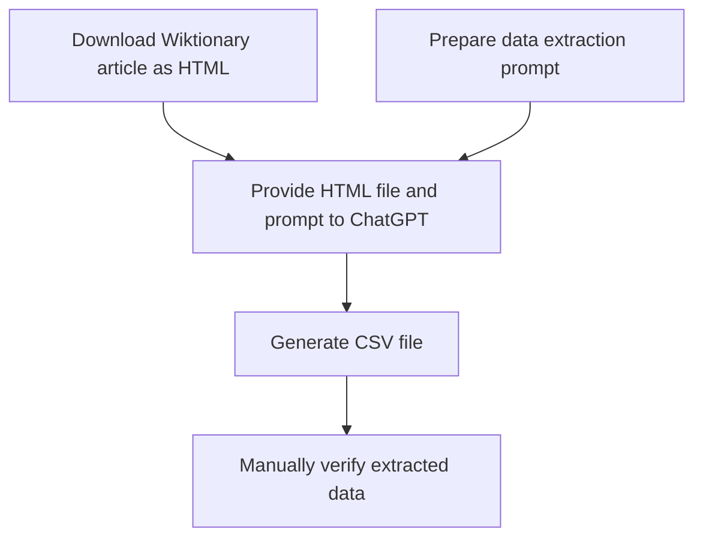

# Data Extraction

## Prompt

You are a data extraction specialist. Your task is to extract Filipino (Tagalog) given names from the provided HTML file, **"Appendix:Tagalog given names – Wiktionary, the free dictionary."**

### Objective

Create a comprehensive CSV file containing all Filipino/Tagalog given names explicitly listed in the HTML document.

### Extraction instructions

1. Thoroughly inspect the entire HTML document, including all relevant tables, lists, headings, and sections containing given names.
2. Extract every individual given name explicitly listed in the document.
3. Include both masculine and feminine given names, as well as gender-neutral names, if identified in the source.
4. Preserve the exact spelling. Capitalizate every name. Remove diacritics. Preserve formatting of each name as presented in the source.
5. Do not generate, invent, assume, or add names that are not explicitly present in the HTML document.
6. Do not exclude uncommon, archaic, or less familiar names simply because they are rarely used.
7. Do not extract surnames, family names, place names, or unrelated vocabulary.
8. If a name appears multiple times, include it only once in the final CSV.
9. If the document categorizes names by gender or another classification, preserve that information where possible.

### CSV structure

Create a CSV file with the following columns:

- `name` – The given name exactly as written in the source.
- sex – Male, Female, Unisex
- deriviation - Spanish, English, Native

### Data quality requirements

- Ensure every row contains a valid given name.
- Remove duplicate entries.
- Do not combine multiple names into a single cell.
- Properly escape commas, quotation marks, and special characters according to CSV standards.
- Use UTF-8 encoding to preserve Filipino characters and diacritics.
- Leave unavailable information blank instead of making assumptions.

### Completeness verification

Before producing the final file:

1. Revisit the entire HTML document to ensure no relevant sections were overlooked.
2. Verify that all names from every relevant list and table have been extracted.
3. Check for accidental omissions and duplicate entries.
4. Count the total number of unique names extracted.
5. Confirm that the CSV can be opened correctly in spreadsheet applications.

### Final deliverable

Generate an actual downloadable file named:

`filipino_given_names.csv`

Do not merely display the CSV contents in your response. Create and provide the actual CSV file.

Also report:

- Total number of unique names extracted.
- Number of male, female, unisex, and unknown entries.
- Any sections of the HTML document that could not be processed.

**Important:** The uploaded HTML document is the sole authoritative source for this task. Completeness and faithful extraction are more important than adding information or making assumptions.